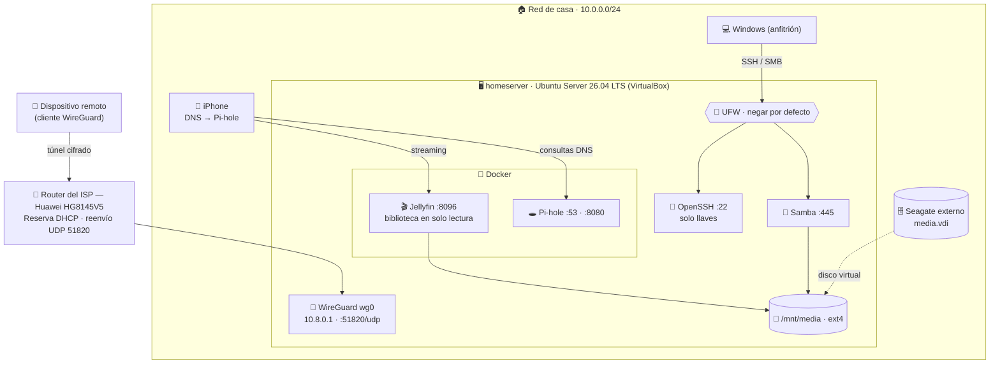

<div align="center">

# 🏠 Homeserver Lab

**Un NAS, servidor multimedia y filtro DNS autoalojado, construido desde cero en una sola laptop y luego endurecido como un servidor de producción.**

🌎 [English](README.md) · **Español**


[Arquitectura](#%EF%B8%8F-arquitectura) · [Bitácora](#-bitácora-de-construcción) · [Incidentes](incidents.md) · [Seguridad](#-seguridad-destacada) · [Hoja de ruta](#%EF%B8%8F-hoja-de-ruta)

</div>

---

## 📌 Resumen

Soy estudiante de Ingeniería en Sistemas y mi meta es trabajar como **analista SOC**. Construí este laboratorio para practicar los fundamentos que un defensor usa a diario: **administración Linux, redes, control de acceso, logs y hardening.**

Sin hardware extra: todo corre en una **VM con Ubuntu Server dentro de mi laptop**, y el contenido multimedia vive en un disco externo.

| | Qué hace |
|---|---|
| 📂 **NAS** | Carpeta compartida accesible desde Windows (Samba), con permisos por grupo |
| 🎬 **Servidor multimedia** | Transmite mi biblioteca al celular, la laptop y la TV (Jellyfin en Docker) |
| 🕳️ **Filtro DNS** | Bloquea anuncios y rastreadores y registra cada consulta DNS (Pi-hole en Docker) |
| 🔐 **Acceso remoto** | Túnel privado con WireGuard, sin servicios expuestos a internet |
| 🛡️ **Endurecido** | SSH solo con llaves, firewall que niega por defecto, mínimo privilegio en todo |

<table>
<tr>
<td><br/><sub>📂 Carpeta del NAS abierta desde Windows</sub></td>
<td><br/><sub>🕳️ Pi-hole con 72 mil dominios bloqueados</sub></td>
</tr>
<tr>
<td><br/><sub>🔎 Log DNS: rastreadores bloqueados en tiempo real</sub></td>
<td><br/><sub>🧱 Firewall que niega por defecto, limitado por subred</sub></td>
</tr>
</table>

---

## 🗺️ Arquitectura



### Diseño de red

| Interfaz | Modo en VirtualBox | Dirección | Función |
|---|---|---|---|
| `enp0s3` | Bridge (en casa) · NAT (fuera) | `10.0.0.78` por reserva DHCP | Red de casa + internet |
| `enp0s8` | Host-only | `192.168.56.101` | Enlace privado laptop ↔ VM |
| `wg0` | WireGuard | `10.8.0.1/24` | Túnel de acceso remoto |

### Servicios y exposición

| Servicio | Puerto | Corre como | Accesible desde |
|---|---|---|---|
| OpenSSH | `22/tcp` | systemd | Casa, host-only, NAT y mi dispositivo VPN — **solo llaves** |
| Samba | `445/tcp` | systemd | Casa, host-only y mi dispositivo VPN |
| Jellyfin | `8096/tcp` | Docker · UID 1000 · biblioteca `:ro` | Casa + WireGuard |
| Pi-hole DNS | `53/tcp+udp` | Docker | Solo en `10.0.0.78` |
| Panel Pi-hole | `8080/tcp` | Docker | Solo en `10.0.0.78` |
| WireGuard | `51820/udp` | kernel | Internet — no responde a paquetes no autenticados |

---

## 🧰 Habilidades demostradas

| Área | Qué hice |
|---|---|
| **Virtualización** | VM en VirtualBox, redes NAT vs bridge vs host-only, reenvío de puertos, discos virtuales |
| **Administración Linux** | Servicios systemd, apt, usuarios y grupos, permisos (setgid), LVM, `/etc/fstab` |
| **Almacenamiento** | Particiones GPT con `parted`, `ext4`, montajes persistentes por UUID |
| **Redes** | Subredes `/24`, reservas DHCP, reenvío de puertos en el router, VLANs, verificación de CGNAT |
| **DNS** | Pi-hole, conflicto del puerto 53 con `systemd-resolved`, `nslookup`, análisis del log de consultas |
| **Contenedores** | Docker Compose, volúmenes, publicación de puertos, `docker exec` / `docker logs` |
| **Seguridad** | Llaves SSH + hardening de `sshd`, UFW, WireGuard, mínimo privilegio, saber que Docker se salta UFW |
| **Troubleshooting y forense** | `dmesg`, `journalctl -k -b -1`, `ffprobe`, `ss`, `loginctl`, leer bytes TLS crudos en un log |

---

## 📚 Bitácora de construcción

Construido en 8 sesiones. Cada guía explica el **por qué**, no solo los comandos. *(Las guías detalladas están en inglés.)*

| # | Sesión | Resultado |
|---|---|---|
| 01 | [Crear la VM](docs/01-vm-setup.md) | Ubuntu Server instalado a mano; LVM corregido para usar todo el disco |
| 02 | [Acceso remoto con SSH](docs/02-ssh.md) | Administración desde PowerShell; distinguir sesiones locales de remotas |
| 03 | [Redes](docs/03-networking.md) | La VM se une a la red de casa; bytes TLS detectados en un log HTTP |
| 04 | [Almacenamiento](docs/04-storage.md) | Disco particionado, formateado y montado automáticamente (tras fallar el paso USB) |
| 05 | [NAS con Samba](docs/05-samba.md) | Carpeta compartida con permisos por grupo, abierta desde Windows |
| 06 | [Docker + Jellyfin](docs/06-docker-jellyfin.md) | Streaming al celular desde un contenedor sin root y en solo lectura |
| 07 | [Pi-hole](docs/07-pihole.md) | Filtro DNS con reserva DHCP y conflicto del puerto 53 resuelto |
| 08 | [Hardening](docs/08-hardening.md) | Llaves SSH, firewall y túnel WireGuard |

---

## 🚨 Registro de incidentes

Las cosas se rompieron, y arreglarlas me enseñó más que el camino fácil. **[Ver todos los incidentes →](incidents.md)**

| Incidente | Causa raíz | Habilidad que demuestra |
|---|---|---|
| Disco USB "ocupado" en VirtualBox | El driver USB del anfitrión se quedó con una petición trabada | Cambiar de estrategia: disco virtual dentro del disco externo |
| Basura `\x16\x03\x01` en un log HTTP | El navegador forzaba HTTPS en un servidor HTTP | Reconocer un ClientHello de TLS en bytes crudos |
| Jellyfin no reproducía en ningún dispositivo | `Input/output error` al leer el archivo | Diagnóstico por eliminación: cliente → FFmpeg → archivo → disco |
| Me quedé fuera de SSH tras el hardening | Passphrase mal escrita + contraseñas desactivadas | Recuperación por consola (fuera de banda) y rotación de llaves |

---

## 🔒 Seguridad destacada

- **SSH solo con llaves.** `PasswordAuthentication no` y `PermitRootLogin no`, en un archivo `00-` para que gane sobre `50-cloud-init.conf`.
- **Firewall que niega por defecto.** Cada puerto permitido está limitado a una subred o a un dispositivo VPN específico.
- **Mínimo privilegio en contenedores.** Jellyfin corre como UID 1000 y ve la biblioteca en **solo lectura**.
- **Docker vs UFW.** Los puertos publicados por Docker se saltan UFW, por eso Pi-hole está atado a una sola IP en vez de `0.0.0.0`.
- **Ningún servicio expuesto a internet.** Solo se reenvía el puerto UDP de WireGuard, que no responde a paquetes no autenticados.
- **Acceso VPN por dispositivo.** Cada dispositivo tiene su propia llave y una dirección `/32`, así se puede revocar uno sin afectar a los demás.
- **`sudo` en vez de `sudo su`.** Cada acción privilegiada queda registrada a nombre de quien la hizo.

---

## 🛣️ Hoja de ruta

- [x] VM, SSH, redes, almacenamiento, Samba, Jellyfin, Pi-hole
- [x] Llaves SSH + hardening de `sshd`
- [x] Firewall UFW
- [x] Servidor WireGuard + reenvío de puerto en el router
- [ ] Probar el túnel desde una red externa
- [ ] Segundo dispositivo (un amigo) con acceso solo a Jellyfin y cuenta sin permisos de admin
- [ ] Respaldos automáticos de configuraciones y llaves
- [ ] Atar Jellyfin a direcciones específicas en vez de `0.0.0.0`
- [ ] Cambiar la contraseña de admin de Jellyfin
- [ ] DDNS para la IP pública dinámica
- [ ] Investigar la interfaz host-only desaparecida (`enp0s8`)
- [ ] Enviar los logs a un SIEM (Wazuh) — próximo proyecto

---

## 📁 Estructura del repositorio

```
homeserver-lab/
├── README.md                 # Inglés
├── README.es.md              # Español
├── incidents.md              # Qué se rompió y cómo lo arreglé
├── docs/
│   ├── 01-vm-setup.md … 08-hardening.md
│   └── images/               # Capturas (datos sensibles censurados)
└── configs/                  # Configuraciones limpias, con marcadores en vez de secretos
    ├── jellyfin/compose.yaml
    ├── pihole/compose.yaml
    ├── samba/smb-share.conf
    ├── ssh/00-hardening.conf
    ├── storage/fstab.example
    ├── ufw/rules.sh
    └── wireguard/{wg0,client}.conf.example
```

> ⚠️ **Entorno de laboratorio.** Las configuraciones están limpias: sin llaves privadas, contraseñas, IPs públicas ni direcciones MAC. Se mantienen las IPs privadas (`10.0.0.x`, `192.168.56.x`) porque hacen las guías más fáciles de seguir.

---

## 👤 Autor

**Keiter Sánchez** — Estudiante de Ingeniería en Sistemas en la UNPHU (República Dominicana), aspirante a analista SOC.

<!-- Agrega tu LinkedIn: [LinkedIn](https://www.linkedin.com/in/tu-usuario) -->
