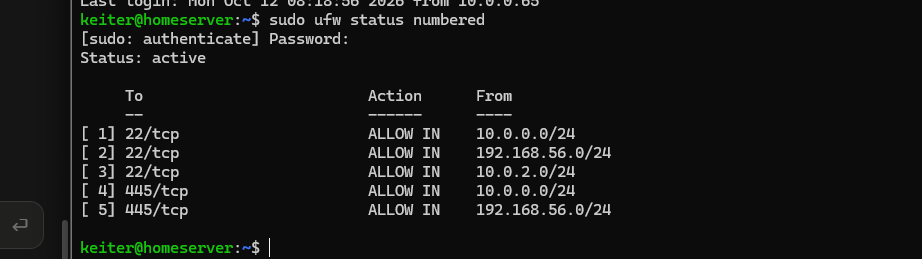
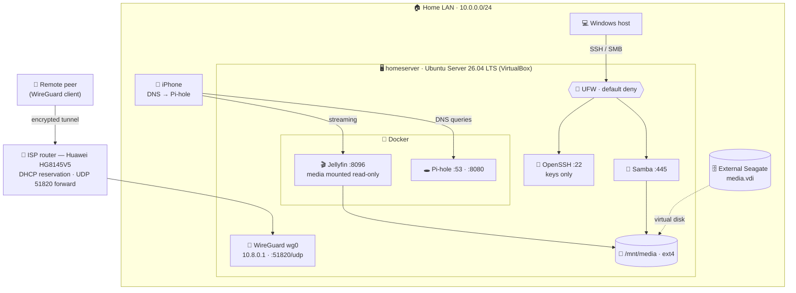

<div align="center">

# 🏠 Homeserver Lab

**A self-hosted NAS, media server and DNS filter — built from scratch on a single laptop, then hardened like a production box.**


[Architecture](#%EF%B8%8F-architecture) · [Build log](#-build-log) · [Incidents](incidents.md) · [Security](#-security-highlights) · [Roadmap](#%EF%B8%8F-roadmap)

</div>

---

## 📌 Overview

I'm a Systems Engineering student working toward a **SOC analyst** role. I built this lab to get hands-on with the fundamentals a defender relies on every day: **Linux administration, networking, access control, logs and hardening.**

No spare hardware: everything runs in an **Ubuntu Server VM on my laptop**, with media stored on an external drive.

| | What it does |
|---|---|
| 📂 **NAS** | Shared folder accessible from Windows (Samba), with group-based permissions |
| 🎬 **Media server** | Streams my library to phone, laptop and TV (Jellyfin in Docker) |
| 🕳️ **DNS filter** | Blocks ads and trackers and logs every DNS query (Pi-hole in Docker) |
| 🔐 **Remote access** | Private WireGuard tunnel — no services exposed to the internet |
| 🛡️ **Hardened** | Key-only SSH, default-deny firewall, least privilege everywhere |

<table>
<tr>
<td><br/><sub>📂 NAS share mounted from Windows</sub></td>
<td><br/><sub>🕳️ Pi-hole with 72k blocked domains</sub></td>
</tr>
<tr>
<td><br/><sub>🔎 DNS query log: trackers blocked in real time</sub></td>
<td><br/><sub>🧱 Default-deny firewall, scoped by subnet</sub></td>
</tr>
</table>

---

## 🗺️ Architecture



### Network layout

| Interface | VirtualBox mode | Address | Role |
|---|---|---|---|
| `enp0s3` | Bridged (home) · NAT (away) | `10.0.0.78` via DHCP reservation | LAN + internet |
| `enp0s8` | Host-only | `192.168.56.101` | Private laptop ↔ VM link |
| `wg0` | WireGuard | `10.8.0.1/24` | Remote-access tunnel |

### Services & exposure

| Service | Port | Runs as | Reachable from |
|---|---|---|---|
| OpenSSH | `22/tcp` | systemd | LAN, host-only, NAT, my WireGuard peer — **keys only** |
| Samba | `445/tcp` | systemd | LAN, host-only, my WireGuard peer |
| Jellyfin | `8096/tcp` | Docker · UID 1000 · media `:ro` | LAN + WireGuard |
| Pi-hole DNS | `53/tcp+udp` | Docker | Bound to `10.0.0.78` only |
| Pi-hole UI | `8080/tcp` | Docker | Bound to `10.0.0.78` only |
| WireGuard | `51820/udp` | kernel | Internet — silent to unauthenticated packets |

---

## 🧰 Skills demonstrated

| Area | What I did |
|---|---|
| **Virtualization** | VirtualBox VM, NAT vs bridged vs host-only networking, port forwarding, virtual disks |
| **Linux administration** | systemd services, apt, users & groups, permissions (setgid), LVM, `/etc/fstab` |
| **Storage** | GPT partitioning with `parted`, `ext4`, UUID-based persistent mounts |
| **Networking** | `/24` subnetting, DHCP reservations, router port forwarding, VLANs, CGNAT check |
| **DNS** | Pi-hole, `systemd-resolved` port-53 conflict, `nslookup`, query-log analysis |
| **Containers** | Docker Compose, volumes, port publishing, `docker exec` / `docker logs` |
| **Security** | SSH keys + `sshd` hardening, UFW, WireGuard, least privilege, Docker-bypasses-UFW awareness |
| **Troubleshooting & forensics** | `dmesg`, `journalctl -k -b -1`, `ffprobe`, `ss`, `loginctl`, reading raw TLS bytes in a log |

---

## 📚 Build log

Built in 8 sessions. Each guide explains the **why**, not just the commands.

| # | Session | Outcome |
|---|---|---|
| 01 | [Building the VM](docs/01-vm-setup.md) | Ubuntu Server installed by hand, LVM fixed to use the full disk |
| 02 | [Remote access with SSH](docs/02-ssh.md) | Managing the server from PowerShell; telling local vs remote sessions apart |
| 03 | [Networking](docs/03-networking.md) | VM joins the home LAN; spotting TLS bytes in an HTTP log |
| 04 | [Storage](docs/04-storage.md) | Partitioned, formatted and auto-mounted a media disk (after USB passthrough failed) |
| 05 | [Samba NAS](docs/05-samba.md) | Group-based shared folder, opened from Windows |
| 06 | [Docker + Jellyfin](docs/06-docker-jellyfin.md) | Streaming to my phone from a non-root, read-only container |
| 07 | [Pi-hole](docs/07-pihole.md) | DNS filtering with a DHCP reservation and a port-53 conflict solved |
| 08 | [Hardening](docs/08-hardening.md) | SSH keys, firewall, WireGuard tunnel |

---

## 🚨 Incident log

Things broke. Fixing them taught me more than the happy path. **[Read all incidents →](incidents.md)**

| Incident | Root cause | Skill it shows |
|---|---|---|
| USB disk "busy" in VirtualBox | Host USB driver kept a stale request | Changing strategy: virtual disk on the external drive |
| `\x16\x03\x01` garbage in an HTTP log | Browser forcing HTTPS on a plain-HTTP server | Recognizing a TLS ClientHello in raw bytes |
| Jellyfin playback failed on every device | `Input/output error` reading the file | Diagnosis by elimination: client → FFmpeg → file → disk |
| Locked out of SSH after hardening | Wrong key passphrase + passwords disabled | Out-of-band console recovery, key rotation |

---

## 🔒 Security highlights

- **Key-only SSH.** `PasswordAuthentication no`, `PermitRootLogin no`, in a `00-` drop-in so it wins over `50-cloud-init.conf`.
- **Default-deny firewall.** Every allowed port is scoped to a specific subnet or WireGuard peer.
- **Least privilege in containers.** Jellyfin runs as UID 1000 with the media library mounted **read-only**.
- **Docker vs UFW.** Docker-published ports bypass UFW, so Pi-hole is bound to a single IP instead of `0.0.0.0`.
- **No inbound services on the internet.** Only WireGuard's UDP port is forwarded, and it never answers unauthenticated packets.
- **Per-peer VPN access.** Each device gets its own key and a `/32` address, so access can be revoked individually.
- **`sudo` over `sudo su`.** Every privileged action is attributable in the logs.

---

## 🛣️ Roadmap

- [x] VM, SSH, networking, storage, Samba, Jellyfin, Pi-hole
- [x] SSH keys + `sshd` hardening
- [x] UFW firewall
- [x] WireGuard server + router port forward
- [ ] Test the tunnel from an external network
- [ ] Second peer (friend) with Jellyfin-only access and a non-admin Jellyfin account
- [ ] Automated backups of configs and keys
- [ ] Bind Jellyfin to specific interfaces instead of `0.0.0.0`
- [ ] Rotate the Jellyfin admin password
- [ ] DDNS for the dynamic public IP
- [ ] Investigate the missing host-only interface (`enp0s8`)
- [ ] Ship logs to a SIEM (Wazuh) — next project

---

## 📁 Repository structure

```
homeserver-lab/
├── README.md
├── incidents.md              # What broke and how I fixed it
├── docs/
│   ├── 01-vm-setup.md … 08-hardening.md
│   └── images/               # Screenshots (sensitive values redacted)
└── configs/                  # Sanitized configs, placeholders instead of secrets
    ├── jellyfin/compose.yaml
    ├── pihole/compose.yaml
    ├── samba/smb-share.conf
    ├── ssh/00-hardening.conf
    ├── storage/fstab.example
    ├── ufw/rules.sh
    └── wireguard/{wg0,client}.conf.example
```

> ⚠️ **Lab environment.** Configs are sanitized: no private keys, passwords, public IPs or MAC addresses. Private RFC 1918 addresses (`10.0.0.x`, `192.168.56.x`) are kept because they make the guides easier to follow.

---

## 👤 Author

**Keiter Sánchez** — Systems Engineering student at UNPHU (Dominican Republic), aspiring SOC analyst.

<!-- Add your LinkedIn: [LinkedIn](https://www.linkedin.com/in/your-handle) -->
