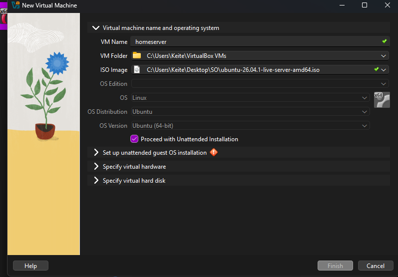
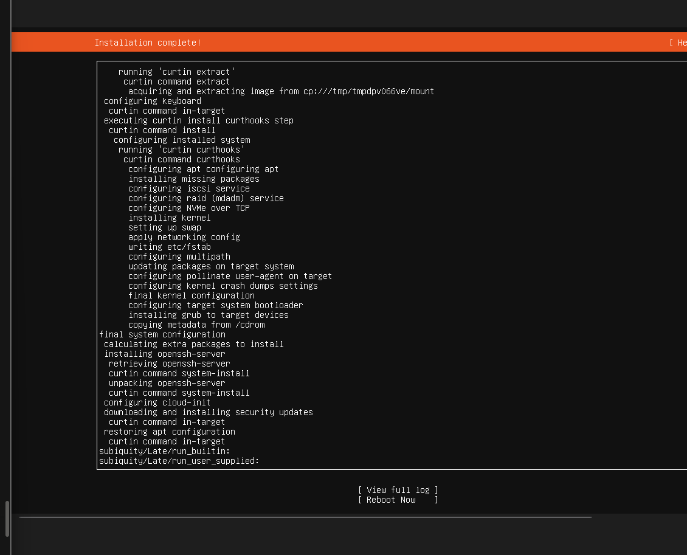

# 01 · Building the VM

> **Goal:** a Linux server running inside my Windows laptop.
> **Win condition:** the `homeserver login:` prompt.

[← README](../README.md) · [Next: SSH →](02-ssh.md)

---

## 🧠 Concepts

| Piece | Role | Analogy |
|---|---|---|
| **VirtualBox** | Hypervisor: runs computers inside my computer | The builder |
| **Ubuntu Server ISO** | Installation image | The blueprint |
| **VM** | The virtual machine itself | The building |

## ⚙️ VM specs

| Setting | Value | Why |
|---|---|---|
| Name | `homeserver` | |
| OS | Ubuntu Server **26.04.1 LTS** | LTS = 5 years of security updates, the enterprise default |
| RAM | 4096 MB | Leaves 12 GB for the Windows host |
| vCPUs | 2 | Enough for Docker + Jellyfin |
| Disk | 40 GB VDI, **dynamically allocated** | Grows as needed; media lives on a separate disk |
| Network | NAT (to start) | Safe on any network |

I **unchecked "Proceed with Unattended Installation"**, so I'd go through every installer decision myself instead of letting VirtualBox do it.



## 🧩 Installer decisions

| Screen | Choice |
|---|---|
| Language | English (errors are easier to search) |
| Install type | Ubuntu Server (not minimized) |
| Network | DHCP from VirtualBox NAT (`10.0.2.15`) |
| Storage | Entire disk with **LVM** |
| Profile | Server name `homeserver`, user `keiter` |
| Ubuntu Pro | Skipped |
| SSH | ✅ **Install OpenSSH server** |
| Snaps | None (Docker installed manually later) |

## ⚠️ Gotcha: LVM only used half the disk

The guided layout created a **19.2 GB** root logical volume and left **19.2 GB free** in the volume group.


**Fix (in the installer):** edit `ubuntu-lv` → set size to the maximum → `/` became **38.4 GB**.

Fix after installation, if you miss it:

```bash
sudo lvextend -r -l +100%FREE /dev/ubuntu-vg/ubuntu-lv
```

`-r` resizes the filesystem along with the volume.



## 🔄 First command on a new server

```bash
sudo apt update && sudo apt upgrade -y
```

| Piece | Meaning |
|---|---|
| `apt update` | Refresh the package catalog |
| `&&` | Run the next command only if this one succeeded |
| `apt upgrade -y` | Install the updates, answering "yes" |

An unpatched server is an open door to known vulnerabilities. Patching is step one.

## ✅ Verification

`lsblk` later confirmed the root volume at **38.4G**.

## 📝 Lessons

- Don't trust installer defaults blindly: read the storage summary.
- LVM makes volumes resizable after the fact.
- The `$` prompt means a normal user; `#` means root.
