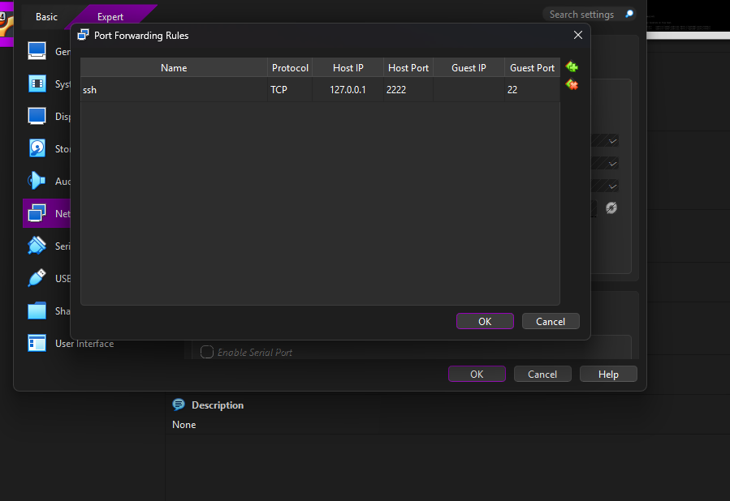

# 02 · Remote access with SSH

> **Goal:** manage the server from PowerShell instead of the VirtualBox window.
> **Win condition:** `keiter@homeserver:~$` inside PowerShell.

[← 01 VM](01-vm-setup.md) · [README](../README.md) · [Next: Networking →](03-networking.md)

---

## 🧠 The problem

In **NAT** mode, the VM lives in a private network inside the laptop. SSH (port 22) is running, but nothing outside can reach it.

**Port forwarding** tells VirtualBox: *"anything that hits port 2222 on the host, send it to port 22 on the VM."*

## 1️⃣ Confirm SSH is listening

```bash
sudo ss -tlnp | grep :22
```

| Flag | Meaning |
|---|---|
| `-t` | TCP only |
| `-l` | Listening sockets only |
| `-n` | Numeric ports |
| `-p` | Show the owning process |

> 🛡️ `ss -tlnp` is one of the first commands to run on a suspicious host: *"which doors are open that shouldn't be?"*

## 2️⃣ Port forwarding rule

| Name | Protocol | Host IP | Host Port | Guest Port |
|---|---|---|---|---|
| `ssh` | TCP | `127.0.0.1` | `2222` | `22` |

Binding to **`127.0.0.1`** means only this laptop can use the forward. Nobody else on a public Wi-Fi can reach it.



## 3️⃣ Connect

```powershell
ssh keiter@127.0.0.1 -p 2222
```

On first connect, SSH shows the server's **host key fingerprint**. Accepting it stores the key; if it ever changes, SSH warns loudly, because that could be a **man-in-the-middle**.

## 🕵️ Who is logged in?

`who` was supposed to show my SSH session. On Ubuntu 26.04 it didn't: it printed the UID `1000` instead of a username, and only the local console.


So I verified with a second source:

```bash
loginctl list-sessions
```


| Session | What it is | Clue |
|---|---|---|
| 2 | VirtualBox console | Has `seat0` and `tty1` |
| 3 | User service manager | `CLASS = manager` |
| 4 | **My SSH session** | No seat, no TTY → **remote** |

Confirm it:

```bash
loginctl show-session 4 -p Remote -p RemoteHost
```

## 📝 Lessons

- **Don't trust a single tool.** When `who` came up empty, `loginctl` gave the real answer.
- **Server logs are in UTC.** Convert before drawing conclusions (UTC−4 for the Dominican Republic).
- **Headless start:** once SSH works, the VM can run without a window.
