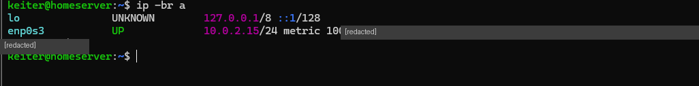
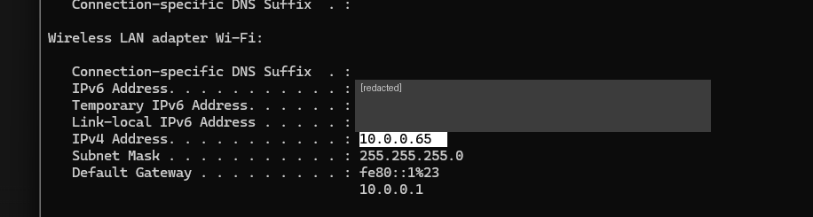
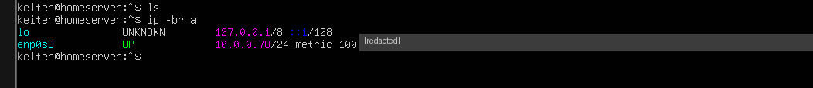
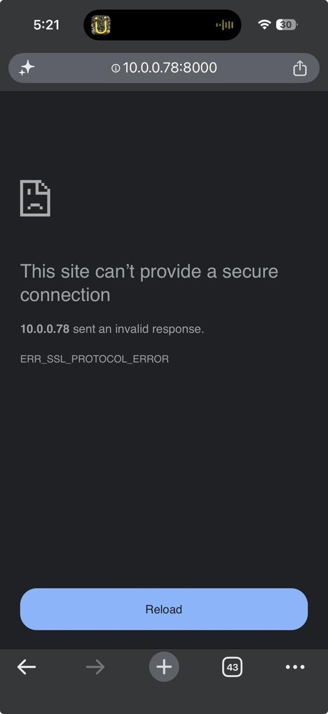
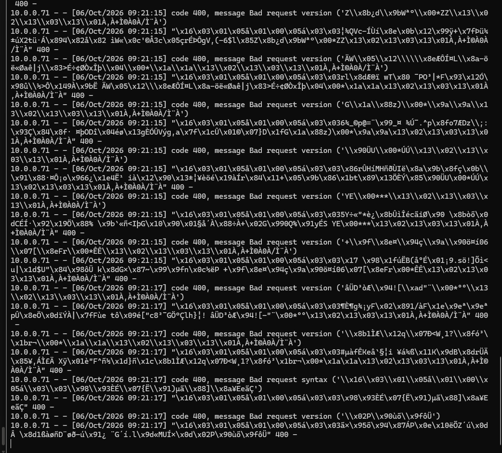

# 03 · Networking

> **Goal:** make the server a regular device on my home network.
> **Win condition:** my phone reaches a page served by the VM.

[← 02 SSH](02-ssh.md) · [README](../README.md) · [Next: Storage →](04-storage.md)

---

## 🧠 Concepts

| Concept | Analogy | Example |
|---|---|---|
| IP address | A house's street address | `10.0.0.78` |
| Subnet `/24` | The neighborhood: first 3 numbers | `10.0.0.x` |
| Gateway | The exit to the world (the router) | `10.0.0.1` |
| Port | A specific door on the house | `22` = SSH |

## 🔍 Two neighborhoods that look alike

| | Laptop (Wi-Fi) | VM (NAT) |
|---|---|---|
| IP | `10.0.0.65` | `10.0.2.15` |
| Mask | `255.255.255.0` | `/24` |
| Neighborhood | `10.0.0.x` | `10.0.2.x` |

Both start with `10.0`, but with a `/24` mask the **third number** is part of the network. `10.0.0` ≠ `10.0.2`, so my phone can't see the VM.




## 🔀 VirtualBox network modes

| Mode | Who can see the VM | Use it when |
|---|---|---|
| **NAT** | Nobody (only via port forwarding) | Away from home, on networks I don't control |
| **Bridged** | Everyone on the LAN | At home |
| **Host-only** | Only the laptop | Private link that works anywhere ([session 05](05-samba.md)) |

After switching Adapter 1 to **Bridged**, the router assigned the VM its own address:



## 📱 Phone test

```bash
python3 -m http.server 8000
```

Opening `10.0.0.78:8000` on my phone failed with `ERR_SSL_PROTOCOL_ERROR`:



The server log was full of garbage and `400` errors:



### 🕵️ Reading the bytes

Almost every line starts with `\x16\x03\x01`:

| Byte | Meaning |
|---|---|
| `\x16` | TLS record type **Handshake** |
| `\x03\x01` | TLS version field |

The browser was forcing **HTTPS** on a plain **HTTP** server, so the server received a TLS ClientHello it couldn't parse and answered `400 Bad Request`.

**The good news:** the source IP `10.0.0.71` was my phone. **The network path worked.** Typing `http://` explicitly in Safari loaded the page (`200 OK`).

> 🛡️ Spotting `\x16\x03` in a log means *"someone is speaking TLS on a port that doesn't expect it"*: useful for detecting scans or misdirected traffic.

## ⚠️ Safety rules

- **Never bridge on networks you don't control** (university, office, café). The server becomes visible to strangers, and on a corporate network it triggers alerts.
- Public Wi-Fi often enables **client isolation**: devices on the same Wi-Fi can't talk to each other.
- Bridged IPs come from **DHCP** and can change. Fixed later with a DHCP reservation ([session 07](07-pihole.md)).

## 📝 Lessons

- `/24` = the first three octets define the network.
- HTTP status codes: `200` OK, `400` the request couldn't be parsed.
- A "failed" test can still prove the important part (the network path).
