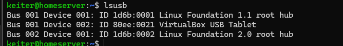
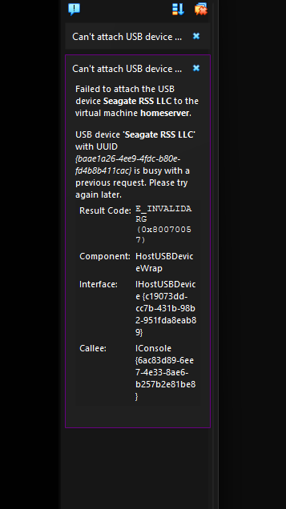
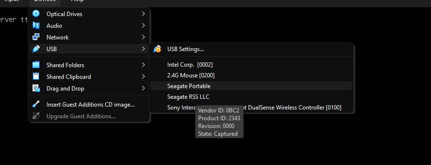
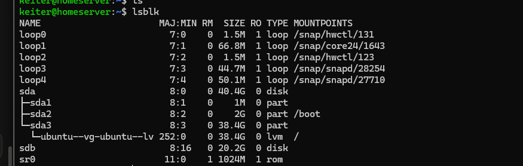
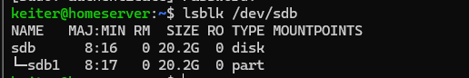
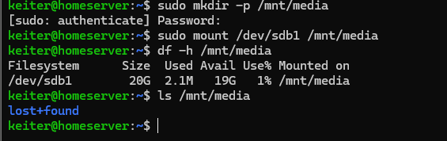
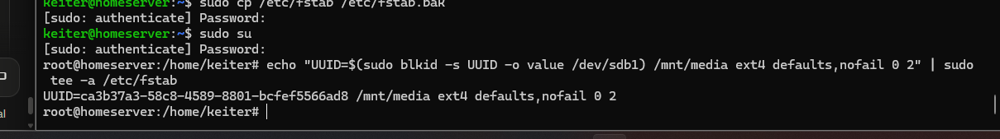
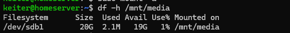

# 04 · Storage

> **Goal:** give the server a dedicated media disk.
> **Win condition:** the disk is mounted at `/mnt/media` and **stays mounted after a reboot**.

[← 03 Networking](03-networking.md) · [README](../README.md) · [Next: Samba →](05-samba.md)

---

## 🧠 How Linux sees disks

There are no drive letters. Disks are files under `/dev` (`/dev/sda`, `/dev/sdb`) and get **mounted** onto folders of a single tree that starts at `/`.

| Step | Analogy |
|---|---|
| Partition table + partition | Drawing the plot and putting up a fence |
| Filesystem (`mkfs`) | Building the shelves and the index |
| Mount | Opening a door from a room in the building |
| `/etc/fstab` | The list of doors opened at every boot |

## 🔌 Plan A: USB passthrough (failed)

I tried to hand the external **Seagate** drive directly to the VM.

1. `lsusb` showed only USB 1.1/2.0 hubs, so the USB 3.0 controller wasn't enabled.

   

2. After enabling **USB 3.0 (xHCI)**, attaching the drive failed every time:

   

3. VirtualBox showed the device as `Captured`, yet `lsblk` never showed a new disk.

   

Removing the USB filter, replugging and rebooting Windows didn't help. Full write-up in [incidents](../incidents.md#4-usb-passthrough-busy-with-a-previous-request).

## 📦 Plan B: a virtual disk on the external drive

Instead of passing the USB device, I created a **dynamically allocated VDI** stored **on the Seagate** and attached it to the VM's SATA controller.

| | USB passthrough | VDI on the external drive |
|---|---|---|
| Reformat the Seagate | Yes | **No** (stays NTFS) |
| Shows up as `sdb` | Yes | Yes |
| Stability | Depends on the host USB driver | Very stable |
| Catch | — | Drive must be connected **before** the VM starts |

I sized it at **20 GB** on purpose for practice.



## 🛠️ Partition, format, mount

> ✅ **Safety check first:** `sda` (40 GB, mounted at `/`) is the system disk. `sdb` (20 GB, nothing mounted) is the target.

```bash
# GPT table + one partition using the whole disk
sudo parted /dev/sdb --script mklabel gpt mkpart media ext4 0% 100%
lsblk /dev/sdb
```



```bash
# ext4 filesystem with label "media"
sudo mkfs.ext4 -L media /dev/sdb1
lsblk -f /dev/sdb

# mount it
sudo mkdir -p /mnt/media
sudo mount /dev/sdb1 /mnt/media
df -h /mnt/media
```



`lost+found` is where ext4 places recovered file fragments after a filesystem check.

## 📌 Make it permanent with `/etc/fstab`

```bash
sudo cp /etc/fstab /etc/fstab.bak      # backup first: a broken fstab can stop the boot
echo "UUID=$(sudo blkid -s UUID -o value /dev/sdb1) /mnt/media ext4 defaults,nofail 0 2" | sudo tee -a /etc/fstab
```

| Field | Meaning |
|---|---|
| `UUID=…` | The partition's permanent ID. `/dev/sdX` names can change; UUIDs don't |
| `defaults` | Standard mount options |
| `nofail` | Boot normally even if the disk is missing |
| `0 2` | No dump; check after the root filesystem |



> ⚠️ In this screenshot I used `sudo su` and became root. Bad habit: see the **least privilege** note below.

### Test without rebooting, then reboot

```bash
sudo umount /mnt/media
sudo systemctl daemon-reload
sudo mount -a            # mounts everything listed in fstab
df -h /mnt/media
```



After `sudo reboot`, the disk was mounted automatically. ✅

## 🛡️ Least privilege: `sudo` vs `sudo su`

| | `sudo command` | `sudo su` |
|---|---|---|
| Scope | One command | Root for the whole session |
| Risk | Low | A typo can wreck the system with no prompt |
| Audit trail | Each command logged under my user | Everything looks like "root" |

## ⚠️ Operating rules

- Connect the Seagate **before** starting the VM.
- `sudo poweroff` **before** unplugging it.

## 📝 Lessons

- When a plan fails three times, change the plan instead of forcing it.
- Always confirm size + mount state before formatting.
- Back up config files before editing them.
