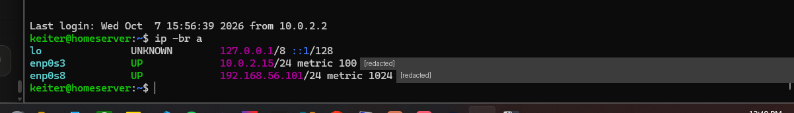
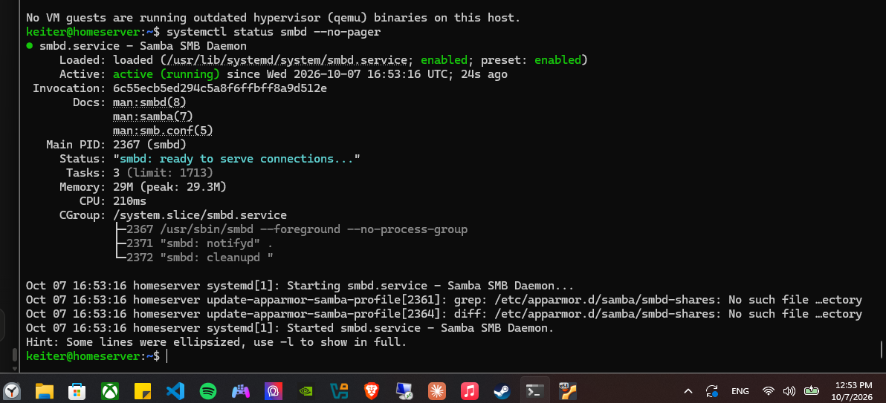
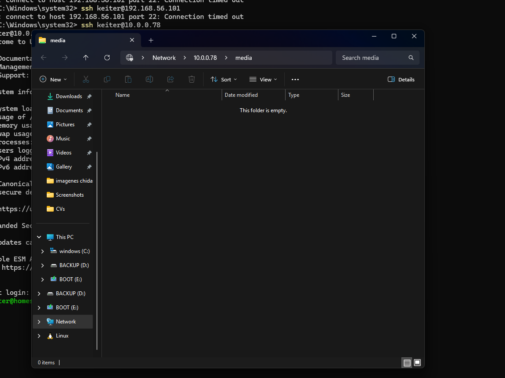

# 05 · Samba NAS

> **Goal:** a server folder that opens from Windows like any other folder.
> **Win condition:** `\\server\media` opens in Explorer.

[← 04 Storage](04-storage.md) · [README](../README.md) · [Next: Docker + Jellyfin →](06-docker-jellyfin.md)

---

## 🧠 Samba in one line

Samba is a front desk: Windows asks for a shared folder over **SMB (port 445)**, Samba checks the guest list, and hands it over if allowed.

## 🔀 Why a host-only network

My first plan was another NAT port forward. That doesn't work: **Windows already uses port 445** for its own file sharing, so it can't be forwarded.

Solution: a second adapter in **Host-only** mode, a private hallway between the laptop and the VM that works on any network.

| Adapter | Mode | Address | Purpose |
|---|---|---|---|
| `enp0s3` | NAT / Bridged | `10.0.2.15` / `10.0.0.78` | Internet |
| `enp0s8` | Host-only | `192.168.56.101` | Laptop ↔ VM |



Note the **`metric`** values (100 vs 1024): with two routes, Linux prefers the lower metric, so internet traffic keeps going through NAT.

## 1️⃣ Install

```bash
sudo apt install samba -y
systemctl status smbd --no-pager
```



| Line | Meaning |
|---|---|
| `enabled` | Starts on every boot |
| `active (running)` | Running now |
| AppArmor `No such file` | Harmless warning; the profile is created later |

## 2️⃣ Permissions: the guest list

```bash
sudo groupadd media
sudo usermod -aG media keiter          # -a = append. Without it you lose your other groups, sudo included
sudo chown root:media /mnt/media
sudo chmod 2775 /mnt/media
```

**Reading `2775`:**

| Digit | Applies to | Meaning |
|---|---|---|
| `2` | Special (setgid) | New files inherit the `media` group |
| `7` | Owner | `rwx` |
| `7` | Group | `rwx` |
| `5` | Others | `r-x` (read only) |

`r=4, w=2, x=1`, so `7 = 4+2+1` and `5 = 4+1`.

## 3️⃣ The share

```bash
sudo cp /etc/samba/smb.conf /etc/samba/smb.conf.bak
```

Appended to `/etc/samba/smb.conf` (see [`configs/samba/smb-share.conf`](../configs/samba/smb-share.conf)):

```ini
[media]
   path = /mnt/media
   valid users = @media
   read only = no
   browseable = yes
   create mask = 0664
   directory mask = 2775
```

`@media` means **the group**: access is granted to a role, not to individual people.

```bash
testparm -s            # Samba's config checker
sudo smbpasswd -a keiter   # Samba keeps its own password database
sudo systemctl restart smbd
```

## 🏁 Result



The folder looks empty because `lost+found` belongs to root: my user can't read it, so Samba doesn't list it. **Permissions working as intended.**

## 📝 Lessons

- **Group-based access control** is the same idea Active Directory uses at scale.
- `usermod -aG`: always with `-a`.
- Back up `smb.conf` and validate with `testparm` before restarting.
