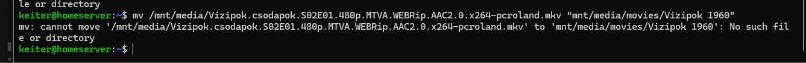
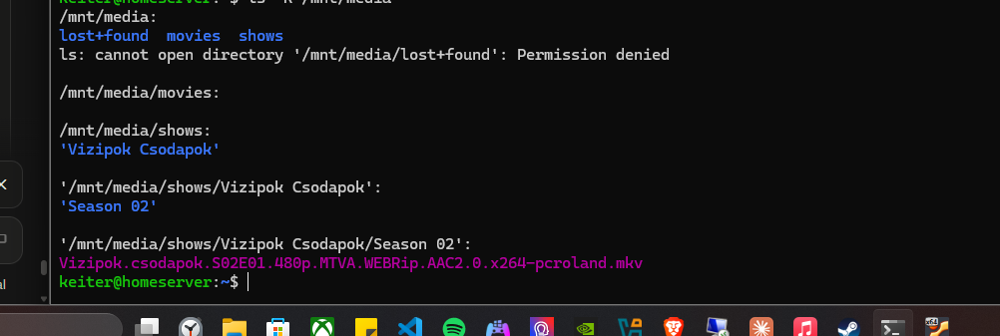
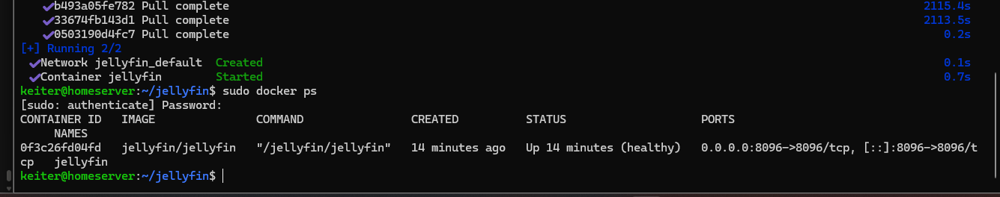
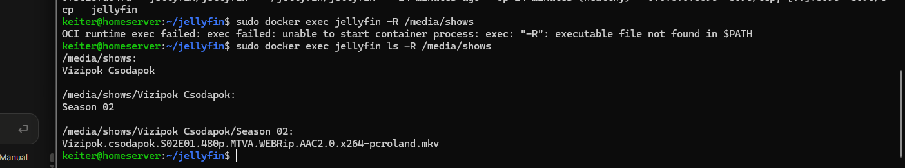
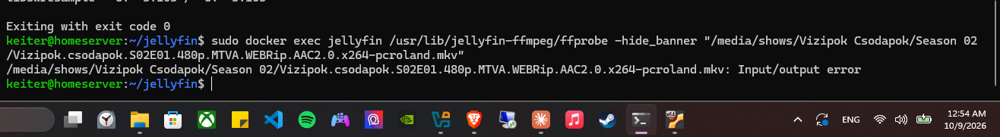
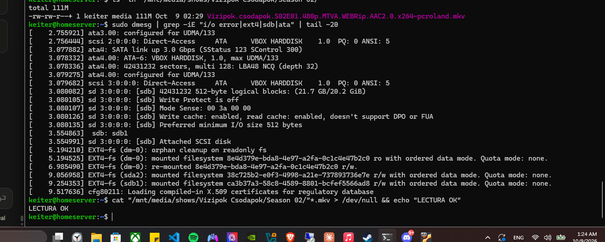
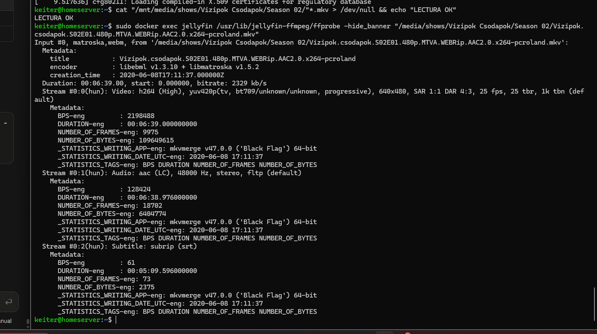

# 06 · Docker + Jellyfin

> **Goal:** my own streaming service, running in a container.
> **Win condition:** an episode plays on my phone.

[← 05 Samba](05-samba.md) · [README](../README.md) · [Next: Pi-hole →](07-pihole.md)

---

## 🧠 Docker vocabulary

| Concept | Analogy |
|---|---|
| **Image** | The mold for a shipping container |
| **Container** | A running box built from that mold |
| **Volume** | A door from the box to my storage |
| **Published port** | The service window people talk through |

## 1️⃣ Install

```bash
sudo apt install docker.io docker-compose-v2 -y
sudo docker run hello-world
```

### 🛡️ Why I keep typing `sudo docker`

Adding a user to the `docker` group avoids `sudo`, but **membership in `docker` is root-equivalent**: any member can start a container that mounts `/` and edit anything on the host. It's a classic privilege-escalation path in CTF machines.

I keep `sudo`, so every Docker command asks for a password and is logged.

## 2️⃣ Organize the library

Jellyfin expects:

```
/mnt/media/movies/Name (Year)/Name (Year).mkv
/mnt/media/shows/Series Name/Season 02/episode.mkv
```

My first `mv` failed because I forgot the leading `/`:



| Path type | Starts with | Resolved from |
|---|---|---|
| Absolute | `/` | The filesystem root |
| Relative | anything else | The current directory |

From `/home/keiter`, `mnt/media/...` became `/home/keiter/mnt/media/...`, which doesn't exist. The file was also an **episode** (`S02E01`), not a movie, so it went under `shows/`.



`Permission denied` on `lost+found` is root-only access, not an error.

## 3️⃣ The compose file

[`configs/jellyfin/compose.yaml`](../configs/jellyfin/compose.yaml):

```yaml
services:
  jellyfin:
    image: jellyfin/jellyfin
    container_name: jellyfin
    user: "1000:1000"
    ports:
      - "8096:8096"
    volumes:
      - ./config:/config
      - ./cache:/cache
      - /mnt/media:/media:ro
    restart: unless-stopped
```

| Line | Security meaning |
|---|---|
| `user: "1000:1000"` | Runs as my user, **not root** |
| `/mnt/media:/media:ro` | **Read-only**: a compromised Jellyfin can't delete or encrypt my files |
| `restart: unless-stopped` | Comes back after reboots |

```bash
sudo docker compose up -d
sudo docker ps
```



> 📌 `0.0.0.0:8096` means "listen on every interface". Reviewed in [hardening](08-hardening.md).

## 4️⃣ Libraries: the container has its own map

Inside the container the library lives at **`/media`**, not `/mnt/media`. Libraries must use the container path:

| Library | Folder |
|---|---|
| Shows | `/media/shows` |
| Movies | `/media/movies` |

Looking through the container's eyes:

```bash
sudo docker exec jellyfin ls -R /media/shows
```



## 🚨 Playback failed on every device

The library loaded, but playback failed on iPhone Safari, iPhone Chrome **and** the laptop. Failing everywhere pointed at the **server**, not the clients.

| Test | Result | Conclusion |
|---|---|---|
| `docker logs` | Stopped playback **at 0 ms** | Failed before the first frame |
| `ffmpeg -version` | Exit code 0 | Transcoder is fine |
| `ffprobe <file>` | **`Input/output error`** | 🎯 The disk failed to return the data |



After a reboot, `dmesg` was clean and the file read fully:



`ffprobe` then showed a healthy file (H.264 + AAC in an MKV container):



Playback worked. 🍿 Root cause analysis in [incidents](../incidents.md#6-jellyfin-playback-fails-on-every-device).

I then added a **Movies** library on my own, and it worked first try.

## 📝 Lessons

- `docker` group = root. Keep `sudo`.
- Least privilege applies to containers too: non-root user + read-only mounts.
- A container sees **its** paths, not the host's.
- Diagnose by elimination, from the outside in.
