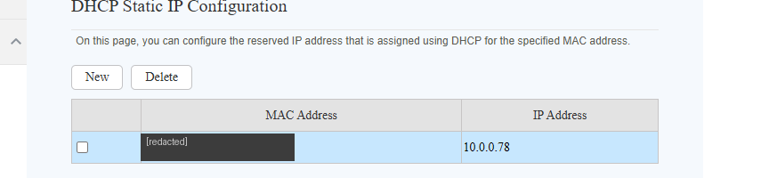
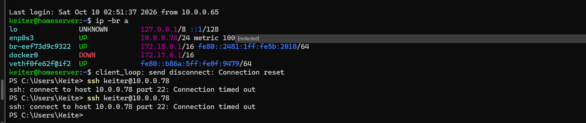
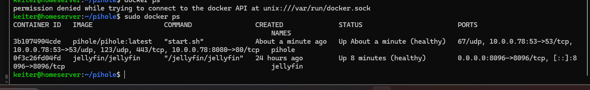
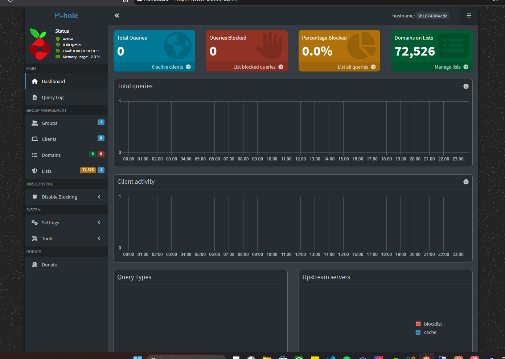
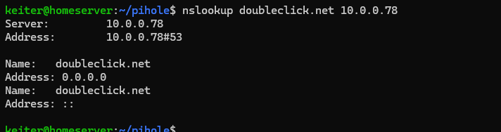
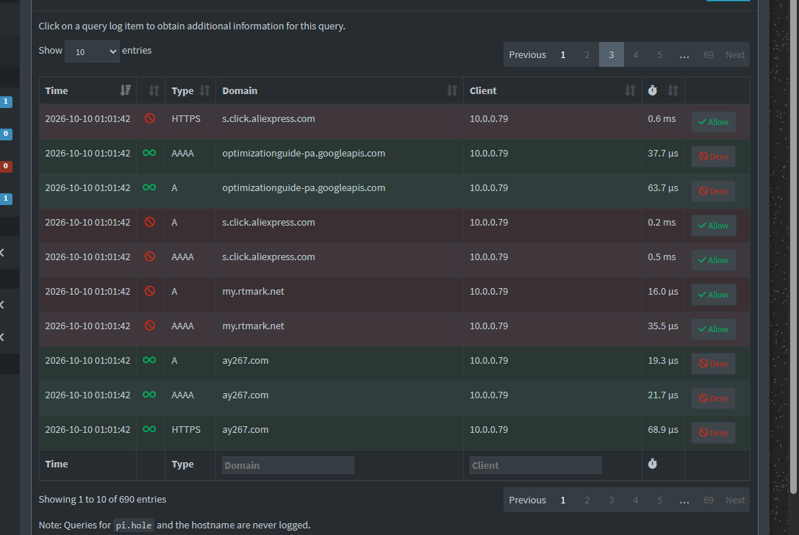

# 07 · Pi-hole

> **Goal:** my own DNS server that blocks ads and trackers.
> **Win condition:** ad domains resolve to `0.0.0.0`, and I can see my phone's DNS traffic.

[← 06 Jellyfin](06-docker-jellyfin.md) · [README](../README.md) · [Next: Hardening →](08-hardening.md)

---

## 🧠 How DNS blocking works

Before loading anything, a device asks DNS *"where does `ads.example` live?"*.

- **Normal DNS** answers with the real address → the ad loads.
- **Pi-hole** checks a blocklist → answers `0.0.0.0` ("nowhere") → the ad never loads.

> 🛡️ DNS logs are gold for a SOC: infected machines almost always "phone home" through DNS lookups to strange domains.

## ⚠️ Design decision: per-device, not router-wide

The server lives on my laptop. If the router pointed the whole house at Pi-hole and the laptop shut down, **everyone would lose internet**. So only my own devices use it, configured manually.

## 1️⃣ A fixed address: DHCP reservation

A DNS server can't change address. I chose a **DHCP reservation** on the router over a static IP inside Ubuntu:

| Method | How | Problem for me |
|---|---|---|
| Static IP in netplan | Server sets its own IP | Breaks networking when I switch to NAT away from home |
| **DHCP reservation** ✅ | Router always gives the VM's MAC the same IP | None |



Notes:
- My home has **two routers**; the second one runs in **access-point mode**, so the main router is the only DHCP server. One network, one DHCP server.
- The VM's MAC starts with `08:00:27`, VirtualBox's vendor prefix: a quick way to spot VMs on a network.

> Before the reservation, a changed DHCP lease once made SSH time out:
> 

## 2️⃣ The port-53 conflict

```bash
sudo ss -tulnp | grep :53
```

Ubuntu's **`systemd-resolved`** already listens on port 53, but only on `127.0.0.53` and `127.0.0.54`.

**Fix:** publish Pi-hole's ports **only on `10.0.0.78`**. No conflict, and DNS isn't exposed on other interfaces.

## 3️⃣ The compose file

[`configs/pihole/compose.yaml`](../configs/pihole/compose.yaml):

```yaml
services:
  pihole:
    image: pihole/pihole:latest
    container_name: pihole
    ports:
      - "10.0.0.78:53:53/tcp"
      - "10.0.0.78:53:53/udp"
      - "10.0.0.78:8080:80/tcp"
    environment:
      TZ: "America/Santo_Domingo"
      FTLCONF_dns_listeningMode: "all"
    volumes:
      - ./etc-pihole:/etc/pihole
    restart: unless-stopped
```

```bash
sudo docker compose up -d
sudo docker exec -it pihole pihole setpassword
```



Two details in that screenshot:

- `permission denied … docker.sock`: running `docker` without `sudo` is refused, as designed.
- Ports **without an arrow** (`67/udp`, `123/udp`, `443/tcp`) exist only inside the container and aren't published.

> ℹ️ Pi-hole won't start away from home (NAT mode): `10.0.0.78` doesn't exist there. That's expected.



## 4️⃣ Testing with `nslookup`

```bash
nslookup google.com 10.0.0.78        # real addresses
nslookup doubleclick.net 10.0.0.78   # blocked
```



`0.0.0.0` (IPv4) and `::` (IPv6) both mean "nowhere".

## 5️⃣ Phone + query log

iPhone → Settings → Wi-Fi → (i) → Configure DNS → Manual → `10.0.0.78`.



| Field | Observation |
|---|---|
| Client `10.0.0.79` | My phone |
| Types `A` / `AAAA` / `HTTPS` | IPv4, IPv6, and the newer HTTPS record |
| 🔴 `s.click.aliexpress.com` | Affiliate click tracker, blocked |
| 🔴 `my.rtmark.net` | Ad network, blocked |
| Times in µs | Answered from cache |

**690 queries in a few minutes** from one phone. 🕵️ An unknown domain allowed in green is exactly what an analyst would look up next (WHOIS, registration date).

## ⚠️ Limitations

| Case | Why it isn't filtered |
|---|---|
| Mobile data | Phone uses the carrier's DNS |
| YouTube / Instagram ads | Served from the same domain as the content |
| iCloud Private Relay or app-level DoH | Bypasses the configured DNS |
| Laptop off | Phone has no working DNS → switch back to Automatic |

## 📝 Lessons

- Reservations beat static IPs when the server moves between networks.
- Two services can share a port number on different addresses.
- DNS logs reveal what every device is really doing.
