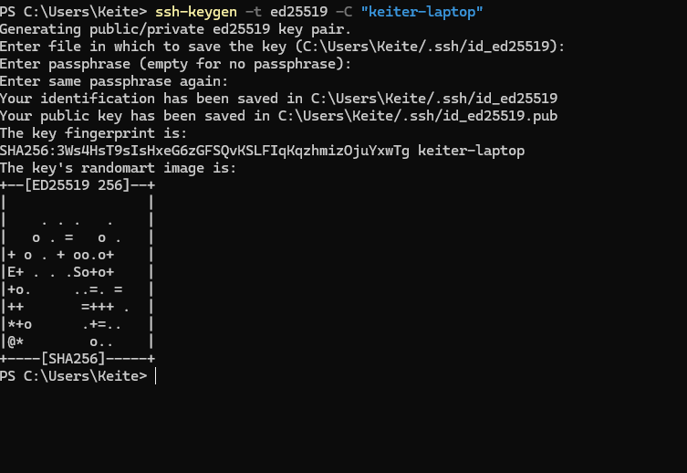
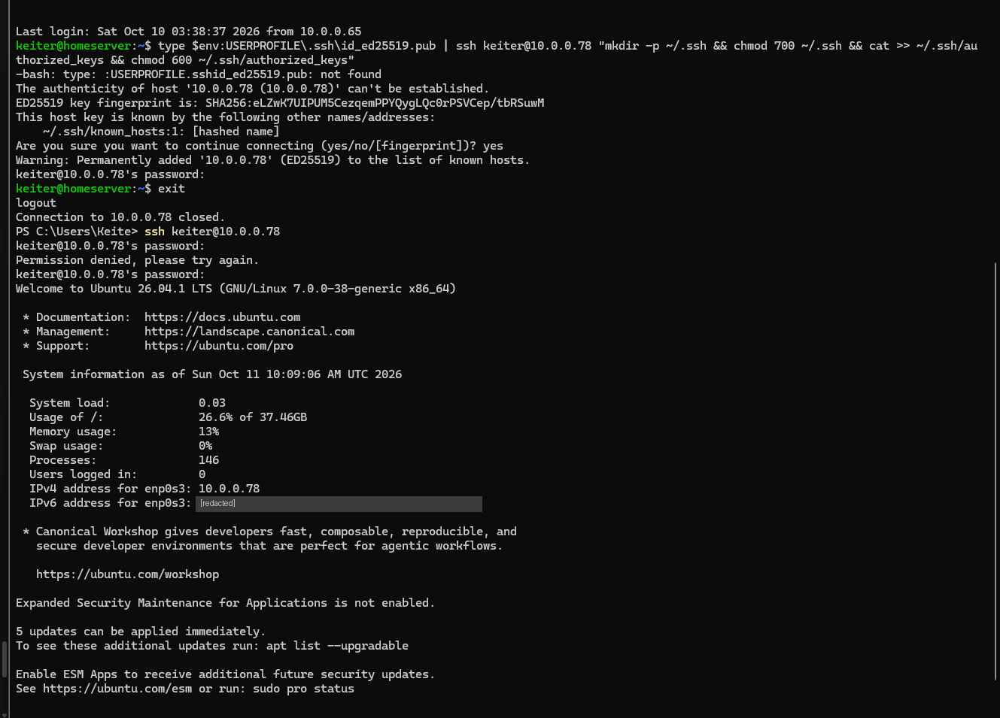
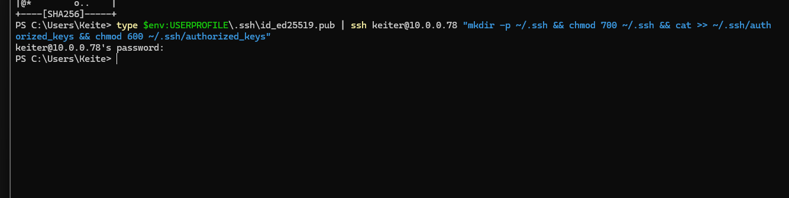
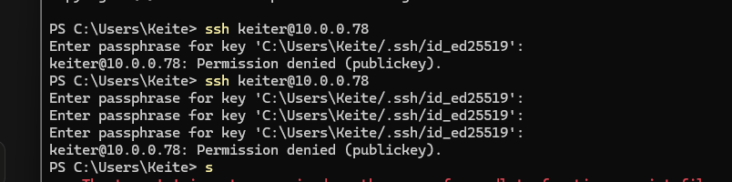
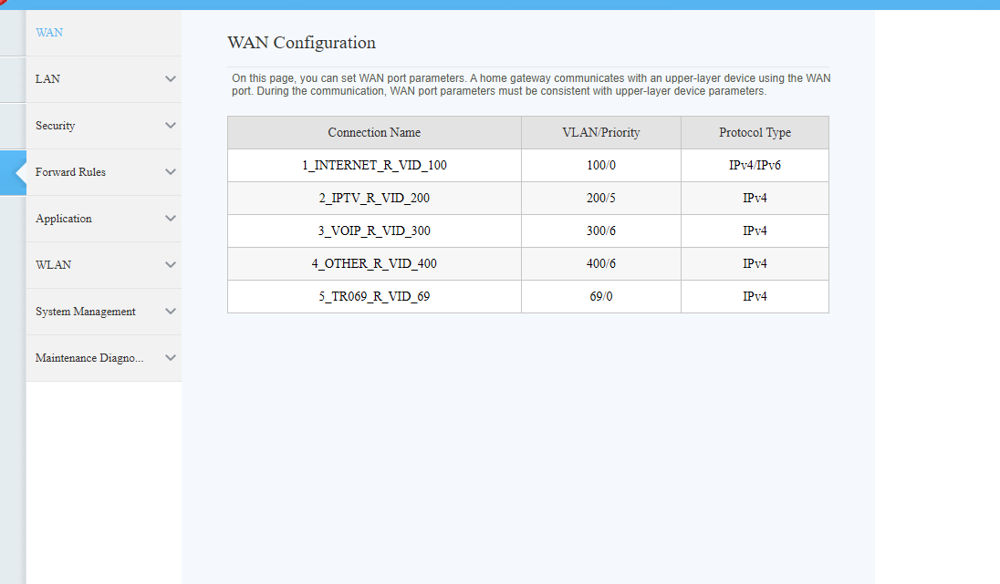
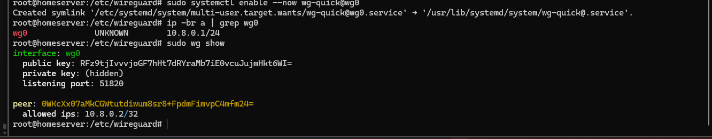
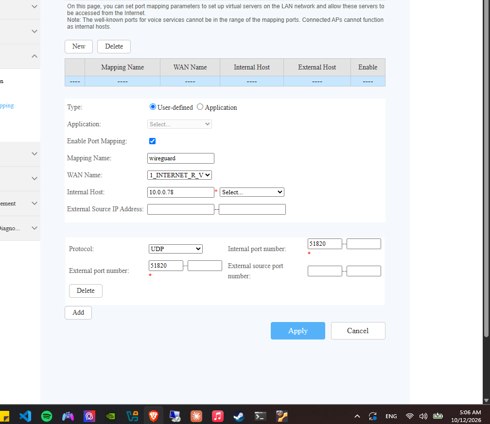

# 08 · Hardening

> **Goal:** harden the server the way a security team would.

[← 07 Pi-hole](07-pihole.md) · [README](../README.md) · [Incidents →](../incidents.md)

---

| Block | Topic | Status |
|---|---|---|
| A | SSH keys + `sshd` hardening | ✅ |
| B | Firewall (UFW) | ✅ |
| C | Remote access (WireGuard) | 🟡 Server ready, external test pending |
| D | Backups | ⏳ Planned |
| E | Leftovers (Jellyfin binding, host-only, admin password) | ⏳ Planned |

---

## 🔑 A · SSH keys

| Key | Lives on | Shared? |
|---|---|---|
| Private `id_ed25519` | My laptop only | ❌ Never |
| Public `id_ed25519.pub` | Server, in `~/.ssh/authorized_keys` | ✅ Safe |
| Passphrase | My head | Unlocks the private key |

On connect, the server sends a challenge, the laptop signs it with the private key, and the server verifies with the public key. The private key never leaves the laptop.

### Generate (PowerShell, on Windows)

```powershell
ssh-keygen -t ed25519 -C "keiter-laptop"
```



### Install the public key on the server

```powershell
type $env:USERPROFILE\.ssh\id_ed25519.pub | ssh keiter@10.0.0.78 "mkdir -p ~/.ssh && chmod 700 ~/.ssh && cat >> ~/.ssh/authorized_keys && chmod 600 ~/.ssh/authorized_keys"
```

`700` / `600` matter: SSH ignores keys whose files are readable by others.

My first attempt ran **on the server instead of Windows**. The prompt said `keiter@homeserver`, not `PS C:\…`:



`$env:USERPROFILE` doesn't exist in bash, so no key was copied, and the server even SSH'd into itself. **Always read the prompt before running a command.**

Run correctly from PowerShell, it succeeds silently. In Linux, no news is good news:



### Turn off passwords

[`configs/ssh/00-hardening.conf`](../configs/ssh/00-hardening.conf) → `/etc/ssh/sshd_config.d/`:

```
PasswordAuthentication no
KbdInteractiveAuthentication no
PermitRootLogin no
```

**Why `00-`?** `sshd` reads drop-ins alphabetically and **the first value wins**. Ubuntu may ship `50-cloud-init.conf` with passwords enabled, so `00-` takes precedence.

```bash
sudo sshd -t                  # validate; silence means OK
sudo systemctl restart ssh
```

**Golden rule:** keep the current session open and test from a **new** window:

```powershell
ssh keiter@10.0.0.78                                   # must work with the key
ssh -o PubkeyAuthentication=no keiter@10.0.0.78        # must fail: Permission denied (publickey)
```

### 🔒 The lockout

A passphrase typo left me with a key I couldn't unlock, and passwords were already disabled:



Recovery through the **VirtualBox console** (out-of-band access), with a rollback and key rotation. Full story in [incidents](../incidents.md#11-locked-out-of-ssh-after-hardening).

---

## 🧱 B · Firewall (UFW)

```bash
sudo ufw default deny incoming
sudo ufw default allow outgoing
```

Then allow only what's needed, from where it's needed ([`configs/ufw/rules.sh`](../configs/ufw/rules.sh)):

| Port | From | Why |
|---|---|---|
| 22/tcp | `10.0.0.0/24`, `192.168.56.0/24`, `10.0.2.0/24` | SSH from home, host-only, and NAT (away from home) |
| 445/tcp | `10.0.0.0/24`, `192.168.56.0/24` | Samba from home and host-only |
| 51820/udp | Anywhere | WireGuard |
| 22, 445/tcp | `10.8.0.2` only | My phone over the VPN; other peers get nothing |


> ⚠️ Forgetting the `10.0.2.0/24` rule would lock me out of SSH whenever the VM runs in NAT mode.

Since every rule is IPv4-scoped, **all inbound IPv6 is denied by default**.

### 🚨 Docker bypasses UFW

Docker writes its own iptables rules, evaluated **before** UFW's. A port published by Docker stays open **even if UFW says no**. That's why:

- Pi-hole is published only on `10.0.0.78`.
- Jellyfin on `0.0.0.0` is on the to-do list (block E).

Many production incidents start this way: an admin trusts the firewall while a database in Docker sits open to the internet.

---

## 🔐 C · Remote access with WireGuard

### Step 0: is there CGNAT?

If the ISP shares one public IPv4 among many customers (CGNAT), nobody outside can reach my router.

**Check:** the router's WAN IPv4 vs `curl -4 ifconfig.me` on the server → **identical**, so no CGNAT and WireGuard can work directly. *(With CGNAT, Tailscale would be the fallback.)*

Along the way, the router's WAN page showed how one fiber carries separate services on **VLANs**, including **TR-069**, the ISP's remote-management channel:



### Keys and server config

```bash
sudo apt install wireguard qrencode -y
sudo mkdir -p /etc/wireguard/clients && cd /etc/wireguard
umask 077   # new files readable by owner only
wg genkey | sudo tee server.key | wg pubkey | sudo tee server.pub
wg genkey | sudo tee clients/iphone.key | wg pubkey | sudo tee clients/iphone.pub
```

The server config is generated by reading the keys from disk, so they never appear on screen (template: [`configs/wireguard/wg0.conf.example`](../configs/wireguard/wg0.conf.example)).

```bash
sudo systemctl enable --now wg-quick@wg0
sudo wg show
```



| Design choice | Why |
|---|---|
| One key pair per device | Revoke one person without touching others; logs map IP → person |
| `AllowedIPs = 10.8.0.2/32` on the server | That key can only use that one address |
| Client `AllowedIPs = 10.8.0.0/24` (split tunnel) | Only lab traffic goes through the VPN |
| Tunnel reaches the server only, not the whole LAN | A stolen phone can't reach my other devices |
| `PersistentKeepalive = 25` | Keeps NAT mappings alive on mobile networks |

### Router port forward

UDP `51820` → `10.0.0.78`:



Exposing a UDP port is safe here: **WireGuard doesn't respond to unauthenticated packets**, so to a scanner the port looks closed.

### Client

```bash
sudo qrencode -t ansiutf8 < /etc/wireguard/clients/iphone.conf
```

The QR is scanned directly from the terminal with the WireGuard app. **Never screenshot it**: it contains the client's private key.

**Status:** server and port forward ready. The external test (from a different network) is pending.

### Planned: a friend with Jellyfin-only access

| Service | Access |
|---|---|
| Jellyfin | ✅ Own non-admin Jellyfin account |
| SSH / Samba | ❌ UFW only allows `10.8.0.2` |
| Home LAN | ❌ Tunnel only reaches the server |

---

## ⏳ D · Backups (planned)

Configs and keys: `/etc/ssh/sshd_config.d/`, `/etc/samba/smb.conf`, `/etc/wireguard/`, compose folders, `/etc/fstab`.

## ⏳ E · Leftovers (planned)

- Bind Jellyfin to specific addresses instead of `0.0.0.0`
- Rotate the Jellyfin admin password
- Investigate the missing `enp0s8` host-only interface
- DDNS for the dynamic public IP
