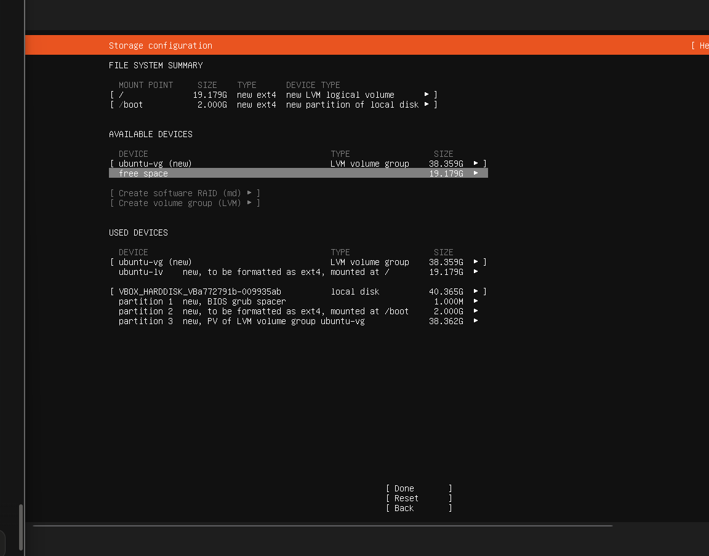
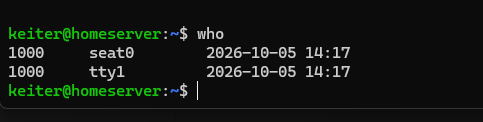
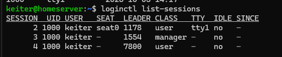

# 🚨 Incident log

Everything that broke while building the lab, written the way I'd document an incident at work.

[← README](README.md)

| # | Incident | Severity | Session |
|---|---|---|---|
| 1 | [LVM only uses half the disk](#1-lvm-only-uses-half-the-disk) | Low | 01 |
| 2 | [`who` doesn't show the SSH session](#2-who-doesnt-show-the-ssh-session) | Low | 02 |
| 3 | [TLS bytes in an HTTP log](#3-tls-bytes-in-an-http-log) | Low | 03 |
| 4 | [USB passthrough busy with a previous request](#4-usb-passthrough-busy-with-a-previous-request) | Medium | 04 |
| 5 | [Samba can't be port-forwarded through NAT](#5-samba-cant-be-port-forwarded-through-nat) | Medium | 05 |
| 6 | [Jellyfin playback fails on every device](#6-jellyfin-playback-fails-on-every-device) | High | 06 |
| 7 | [`mv` fails: relative vs absolute path](#7-mv-fails-relative-vs-absolute-path) | Low | 06 |
| 8 | [SSH times out after an address change](#8-ssh-times-out-after-an-address-change) | Medium | 05 / 07 |
| 9 | [Port 53 already in use](#9-port-53-already-in-use) | Medium | 07 |
| 10 | [Command run on the wrong host](#10-command-run-on-the-wrong-host) | Medium | 08 |
| 11 | [Locked out of SSH after hardening](#11-locked-out-of-ssh-after-hardening) | High | 08 |

---

## 1. LVM only uses half the disk

| | |
|---|---|
| **Symptom** | Installer summary: `/` = 19.2 GB on a 40 GB disk, 19.2 GB "free space" in `ubuntu-vg` |
| **Root cause** | Ubuntu's guided LVM layout deliberately leaves part of the volume group unallocated |
| **Fix** | Edited `ubuntu-lv` to the maximum size → 38.4 GB. Post-install: `sudo lvextend -r -l +100%FREE /dev/ubuntu-vg/ubuntu-lv` |
| **Lesson** | Read installer summaries instead of clicking through |

---

## 2. `who` doesn't show the SSH session

| | |
|---|---|
| **Symptom** | While connected over SSH, `who` listed only `seat0` / `tty1`, with UID `1000` instead of a username |
| **Investigation** | Cross-checked with `loginctl list-sessions`: one session had no seat and no TTY |
| **Root cause** | On this Ubuntu release, `who` reads a legacy login record that no longer reflects every session |
| **Fix** | Use `loginctl` (and `loginctl show-session <id> -p Remote -p RemoteHost`) |
| **Lesson** | Never rely on a single source of truth during an investigation |

 

---

## 3. TLS bytes in an HTTP log

| | |
|---|---|
| **Symptom** | Phone showed `ERR_SSL_PROTOCOL_ERROR`; server log full of binary junk and `400 Bad Request` |
| **Investigation** | Every bad line started with `\x16\x03\x01` |
| **Root cause** | The browser upgraded to HTTPS automatically; `\x16` = TLS Handshake record, `\x03\x01` = version. A plain-HTTP server can't parse a TLS ClientHello |
| **Fix** | Typed `http://` explicitly in Safari → `200 OK` |
| **Lesson** | The source IP proved the network path worked. Recognizing TLS in raw bytes helps spot scans and misdirected traffic |

---

## 4. USB passthrough busy with a previous request

| | |
|---|---|
| **Symptom** | `Failed to attach the USB device … is busy with a previous request` (`E_INVALIDARG`). Device shown as `Captured`, but no new disk in `lsblk` |
| **Investigation** | `lsusb` first showed no USB 3.0 hub → enabled xHCI. Then removed the USB filter (filter + manual attach were competing), replugged, rebooted the Windows host. Same error each time |
| **Root cause** | The VirtualBox host USB driver on Windows kept a stale request for the device |
| **Fix** | **Changed strategy:** a dynamically allocated VDI stored on the external drive, attached to the VM's SATA controller |
| **Lesson** | After three failed attempts, switch plans. The VDI approach is also more stable for a server used daily |

---

## 5. Samba can't be port-forwarded through NAT

| | |
|---|---|
| **Symptom** | Plan was to forward a host port to the VM's SMB port, like SSH |
| **Root cause** | Windows itself uses TCP 445 for file sharing, so the host port can't be handed to VirtualBox |
| **Fix** | Added a **host-only** adapter: the laptop reaches the VM directly at `192.168.56.101`, on any network |
| **Lesson** | Know which ports the host OS already owns |

---

## 6. Jellyfin playback fails on every device

| | |
|---|---|
| **Symptom** | `Playback failed because the media is not supported by this client` on iPhone Safari, iPhone Chrome and the laptop |
| **Investigation** | Failing on all clients → server-side. `docker logs`: stopped at **0 ms**. `ffmpeg -version`: OK. `ffprobe <file>`: **`Input/output error`** |
| **Root cause** | A transient read error somewhere in the chain **USB → NTFS → VDI → ext4**. After a reboot: `dmesg` clean, full read OK, `ffprobe` healthy |
| **Fix** | Rebooted, re-verified, playback worked |
| **Follow-up** | If it recurs, check the previous boot's kernel log before it's gone: `sudo journalctl -k -b -1 \| grep -iE "i/o error\|sdb\|ext4-fs error"` |
| **Lesson** | Eliminate suspects from the outside in. `Input/output error` is a storage problem, not a codec problem |

---

## 7. `mv` fails: relative vs absolute path

| | |
|---|---|
| **Symptom** | `mv: cannot move … to 'mnt/media/movies/…': No such file or directory` |
| **Root cause** | Missing leading `/`: the path was resolved from `/home/keiter` |
| **Fix** | Absolute path `/mnt/media/...`; also moved the file under `shows/` since it was an episode (`S02E01`) |
| **Lesson** | Use **Tab** completion; know absolute vs relative paths |

---

## 8. SSH times out after an address change

| | |
|---|---|
| **Symptom** | `ssh: connect to host … port 22: Connection timed out` |
| **Investigation** | `timed out` = nobody answered (vs `refused` = reached the host, door closed). Checked the VM's addresses from the console |
| **Root cause** | The VM's DHCP-assigned address had changed |
| **Fix** | Short term: connected to the new address. Long term: **DHCP reservation** on the router (VM MAC → `10.0.0.78`) |
| **Lesson** | Anything others must find (servers, DNS, printers) needs a stable address; it also keeps IP → host stable in logs |

---

## 9. Port 53 already in use

| | |
|---|---|
| **Symptom** | Pi-hole needs port 53, but `ss -tulnp \| grep :53` showed it taken |
| **Root cause** | `systemd-resolved`'s stub listener on `127.0.0.53` and `127.0.0.54` |
| **Fix** | Published Pi-hole only on `10.0.0.78:53`. Different address, no conflict, smaller exposure |
| **Lesson** | Ports are per address. Binding to one IP is also a security control |

---

## 10. Command run on the wrong host

| | |
|---|---|
| **Symptom** | `-bash: type: :USERPROFILE.sshid_ed25519.pub: not found`, then a host-key prompt for the server itself |
| **Root cause** | A PowerShell command was pasted into the **server's** shell. Bash doesn't know `$env:USERPROFILE`, and the `ssh` part made the server connect to itself |
| **Fix** | `exit`, check the prompt shows `PS C:\…`, rerun |
| **Lesson** | Read the prompt before pressing Enter. In production, the wrong host can be an expensive mistake |

---

## 11. Locked out of SSH after hardening

| | |
|---|---|
| **Symptom** | After disabling password authentication: `Permission denied (publickey)` even with the correct key file |
| **Root cause** | The key's passphrase had been typed with an unintended character, so it couldn't be unlocked. Passwords were already off, so there was no fallback |
| **Recovery** | 1. Logged in through the **VirtualBox console** (out-of-band access). 2. Temporarily moved `00-hardening.conf` to `/root/` and restarted `ssh`. 3. Generated a new key pair with a plain alphanumeric passphrase. 4. Replaced `authorized_keys` using `>` (overwrite) instead of `>>` (append), removing the old key. 5. Restored the hardening file, validated with `sshd -t`, tested key login and password rejection |
| **Lesson** | Always keep an out-of-band path and an open session when changing access controls. The lockout also proved the hardening worked: no valid key, no entry |

